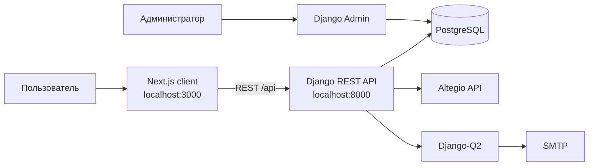

# IMA Pro Space

> Цифровое пространство для презентации помещений, услуг и B2B-конфигураций IMA.

[](./client)
[](./server)
[](#технологический-стек)
[](#локализация)

IMA Pro Space — full-stack приложение с двуязычным Next.js-интерфейсом и Django REST API. Пользователь может изучить доступные помещения и услуги, открыть детальную страницу комнаты, записаться на услугу через интеграцию с Altegio и собрать B2B-конфигурацию. Контент и заявки управляются через Django Admin.

## Содержание

- [Возможности](#возможности)
- [Архитектура](#архитектура)
- [Технологический стек](#технологический-стек)
- [Структура репозитория](#структура-репозитория)
- [Быстрый старт](#быстрый-старт)
- [Настройка окружения](#настройка-окружения)
- [Команды разработки](#команды-разработки)
- [Маршруты приложения](#маршруты-приложения)
- [REST API](#rest-api)
- [Модели данных](#модели-данных)
- [Локализация](#локализация)
- [Фоновые задачи и e-mail](#фоновые-задачи-и-e-mail)
- [Деплой](#деплой)
- [Тестирование и качество](#тестирование-и-качество)
- [Рабочий процесс](#рабочий-процесс)

## Возможности

- Каталог опубликованных помещений с фотографиями, специализацией и описанием.
- Каталог услуг, стоимости, содержимого и оборудования услуги.
- Детальная страница помещения и сценарий записи на услугу.
- Получение доступных дат и времени записи через Altegio.
- B2B-конфигуратор с пошаговой формой и готовыми вариантами конфигураций.
- Приём B2B-заявок с контактами, датой, заметками и выбранными типами.
- Управление комнатами, услугами, B2B-типами и заявками через административную панель.
- Переключение языков `cz` и `ru` на уровне маршрута.
- Анимации интерфейса на GSAP и Motion, уведомления через React Toastify.

## Архитектура



Репозиторий разделён на два независимых приложения:

- [`client/`](./client) — веб-интерфейс на Next.js App Router.
- [`server/`](./server) — API, бизнес-модели, админ-панель и интеграции на Django.

Клиент обращается к серверу через Redux Toolkit Query. Базовый URL API задаётся переменной `NEXT_PUBLIC_BASE_URL`, поэтому один и тот же интерфейс можно подключить к локальным и production-окружениям.

## Технологический стек

### Frontend

- Next.js `16.3` и React `19`.
- TypeScript.
- App Router и `next-intl` для маршрутизации и переводов.
- Redux Toolkit, React Redux и RTK Query.
- Ant Design.
- Tailwind CSS `4`.
- GSAP, `@gsap/react` и Motion.
- React Hook Form и React Toastify.
- `pnpm` как пакетный менеджер.

### Backend

- Python и Django `6.0`.
- Django REST Framework.
- PostgreSQL через `psycopg2-binary`.
- Django CORS Headers и WhiteNoise.
- Django Unfold для административной панели.
- Django-Q2 для фоновых задач.
- Gunicorn/Daphne для запуска приложения.
- Altegio API для услуг, комнат и расписания.

## Структура репозитория

```text
.
├── client/
│   ├── app/[locale]/(main)/  # страницы cz и ru
│   ├── app/lib/store/        # Redux store и RTK Query
│   ├── app/ui/               # layout, header, footer, стили и шрифты
│   ├── messages/             # переводы cz.json и ru.json
│   ├── i18n/                 # конфигурация next-intl
│   └── public/               # статические файлы
├── server/
│   ├── api/                  # REST viewsets, serializers и Altegio-интеграция
│   ├── booking/              # комнаты, услуги и миграции
│   ├── b2b/                  # B2B-модели, заявки и фоновые задачи
│   ├── config/               # настройки, URL, ASGI/WSGI
│   ├── templates/            # e-mail шаблоны
│   ├── manage.py
│   └── requirements.txt
└── README.md
```

## Быстрый старт

### Предварительные требования

- Node.js, совместимый с Next.js 16.
- `pnpm` `11.25.0` (версия зафиксирована в `client/package.json`).
- Python, совместимый с Django 6.
- PostgreSQL  — локальная конфигурация сервера ожидает PostgreSQL.
- Доступ к Altegio API, если нужны реальные комнаты, услуги и расписание.

### 1. Запуск сервера

```bash
cd server
python -m venv .venv
source .venv/bin/activate       # Windows: .venv\Scripts\activate
pip install -r requirements.txt
```

Создайте файл `server/.env` и укажите как минимум секрет Django и параметры подключения к PostgreSQL. Полный список переменных — в разделе [Настройка окружения](#настройка-окружения).

```bash
python manage.py migrate
python manage.py createsuperuser
python manage.py runserver
```

API и админ-панель будут доступны по адресам:

- `http://localhost:8000/api/`
- `http://localhost:8000/api/admin/`

### 2. Запуск клиента

В отдельном терминале:

```bash
cd client
pnpm install
```

Создайте `client/.env.local`:

```dotenv
NEXT_PUBLIC_BASE_URL=http://localhost:8000
```

Запустите dev-сервер:

```bash
pnpm dev
```

Откройте [`http://localhost:3000`](http://localhost:3000). Главная страница использует локаль по умолчанию `cz`; русская версия доступна по адресу `/ru`.

## Настройка окружения

### Client: `client/.env.local`

| Переменная | Назначение | Пример |
| --- | --- | --- |
| `NEXT_PUBLIC_BASE_URL` | URL Django API без завершающего `/api` | `http://localhost:8000` |

### Server: `server/.env`

| Переменная | Назначение |
| --- | --- |
| `SECRET_KEY` | Секретный ключ Django |
| `PROD` | При значении `True` подключает production-настройки |
| `LOCALE_IP` | Хост PostgreSQL для локального режима |
| `DB_NAME` | Имя production-базы |
| `DB_USER` | Пользователь production-базы |
| `DB_PASSWORD` | Пароль production-базы |
| `DB_HOST` | Хост production-базы |
| `DB_PORT` | Порт production-базы, по умолчанию `5432` |
| `ALLOWED_HOSTS` | Список разрешённых хостов через запятую |
| `CORS_ALLOWED_ORIGINS` | Origin клиентского приложения |
| `EMAIL_HOST` | SMTP-хост |
| `EMAIL_PORT` | SMTP-порт |
| `EMAIL_HOST_USER` | SMTP-пользователь |
| `EMAIL_HOST_PASSWORD` | SMTP-пароль |

> Не храните `.env` в Git и не вставляйте реальные ключи, пароли или токены в документацию. В production обязательно задайте `SECRET_KEY`, список `ALLOWED_HOSTS` и разрешённый CORS origin явно.

## Команды разработки

### Client

```bash
pnpm dev       # разработка с hot reload
pnpm lint      # ESLint
pnpm build     # production-сборка
pnpm start     # запуск production-сборки
```

### Server

```bash
python manage.py runserver       # локальный HTTP-сервер
python manage.py makemigrations  # создать миграции после изменения моделей
python manage.py migrate         # применить миграции
python manage.py test            # тесты Django-приложений
python manage.py collectstatic   # собрать static-файлы
python manage.py qcluster        # worker Django-Q2
```

Для production-сборки сервер также предоставляет [`server/build.sh`](./server/build.sh): установка зависимостей, сборка static-файлов, миграции и попытка создать superuser без интерактивного ввода.

## Маршруты приложения

| Маршрут | Назначение |
| --- | --- |
| `/` или `/cz` | Главная страница на чешском |
| `/ru` | Главная страница на русском |
| `/{locale}/room` | Каталог/сценарий работы с помещениями |
| `/{locale}/b2b` | B2B-конфигуратор |

Поддерживаемые локали: `cz`, `ru`. Неизвестная или отсутствующая локаль заменяется на `cz`.

## REST API

Все ресурсы доступны с префиксом `/api/`. Django REST Framework Router предоставляет стандартные операции списка, получения, создания, изменения и удаления там, где они поддержаны соответствующим viewset.

| Endpoint | Назначение |
| --- | --- |
| `GET /api/rooms/` | Опубликованные помещения |
| `GET /api/rooms/top/` | Основная/топовая выборка помещений |
| `GET /api/rooms/{id}/` | Помещение с услугами |
| `GET /api/rooms/available-dates/{staff_id}/` | Доступные даты записи |
| `POST /api/rooms/available-time/` | Доступное время записи |
| `POST /api/rooms/create/` | Создание записи на услугу |
| `GET /api/services/` | Список услуг |
| `GET /api/services/{id}/` | Детали услуги |
| `/api/b2b/` | B2B-заявки |
| `/api/b2b-types/` | Типы B2B-конфигураций |
| `/api/b2b-ready-selected/` | Готовые варианты B2B |
| `/api/admin/` | Django Admin |

Форматы входных данных и ответа определяются сериализаторами в [`server/api/alteg/`](./server/api/alteg) и [`server/api/B2B/`](./server/api/B2B). Для точной проверки доступных методов в запущенном окружении можно использовать browsable API DRF.

## Модели данных

### Booking

- `Room` — помещение, его изображение, специализация, описание, публикация и связанные услуги.
- `Service` — услуга, внешний `altegio_id`, стоимость и комментарий.
- `ServiceContent` — содержимое услуги.
- `ServiceEquipment` — оборудование услуги.

### B2B

- `B2BTypes` — доступный тип B2B-конфигурации.
- `ReadySelectedB2B` — готовый вариант конфигурации.
- `B2BRequests` — заявка клиента, контакты, выбранные типы, дата, заметки и статус `PENDING`/`APPROVED`.

Изменения схемы должны сопровождаться миграциями в `server/booking/migrations/` или `server/b2b/migrations/`.

## Локализация

Переводы находятся в [`client/messages/`](./client/messages):

- `cz.json` — чешская локаль и локаль по умолчанию.
- `ru.json` — русская локаль.

При добавлении нового ключа перевода обновляйте оба файла и проверяйте страницу в обеих локалях. Маршрутизация локалей настроена в [`client/i18n/routing.ts`](./client/i18n/routing.ts), а загрузка сообщений — в [`client/i18n/request.ts`](./client/i18n/request.ts).

## Фоновые задачи и e-mail

Django-Q2 настроен с очередью `b2b_tasks` и четырьмя worker-процессами. В production worker запускается отдельно от web-процесса:

```bash
python manage.py qcluster
```

SMTP-параметры используются сервером для отправки уведомлений по B2B-сценариям. HTML-шаблон письма находится в [`server/templates/email/b2b_configuration/index.html`](./server/templates/email/b2b_configuration/index.html).

## Деплой

### Backend

1. Установите зависимости из `server/requirements.txt`.
2. Задайте `PROD=True` и production-переменные PostgreSQL/SMTP.
3. Выполните `server/build.sh`.
4. Запустите web-процесс через Gunicorn и отдельный worker Django-Q2.
5. Проверьте `ALLOWED_HOSTS`, CORS и HTTPS-настройки перед публикацией.

> Перед production-деплоем проверьте `server/Procfile`: команда web должна ссылаться на фактический WSGI-модуль `config.wsgi:application`.

### Frontend

```bash
cd client
pnpm install --frozen-lockfile
pnpm build
pnpm start
```

Перед сборкой задайте `NEXT_PUBLIC_BASE_URL` на публичный адрес backend API. Next.js разрешает удалённые изображения только с хостов, перечисленных в `client/next.config.*`.

## Тестирование и качество

Перед отправкой изменений рекомендуется выполнить:

```bash
cd client && pnpm lint && pnpm build
cd ../server && python manage.py test
```

Если менялись модели Django, сначала создайте и примените миграции. Если менялись API-контракты, проверьте соответствующий RTK Query endpoint и оба языка интерфейса.

## Рабочий процесс

1. Создайте ветку от актуального `main`.
2. Для frontend-изменений работайте в `client/`, для API и данных — в `server/`.
3. Не коммитьте `.env`, дампы баз данных, секреты и локальные артефакты сборки.
4. Запускайте lint/build или backend-тесты в зависимости от затронутого слоя.
5. В описании изменения фиксируйте миграции, новые переменные окружения и изменения API.

## Лицензия

Лицензия в репозитории не указана. Уточните правила использования и распространения проекта у владельцев IMA Pro Space перед публичной публикацией.
